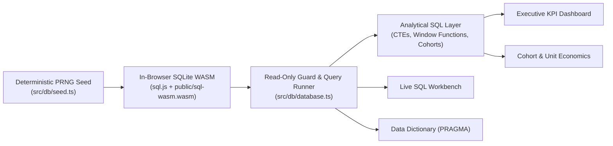
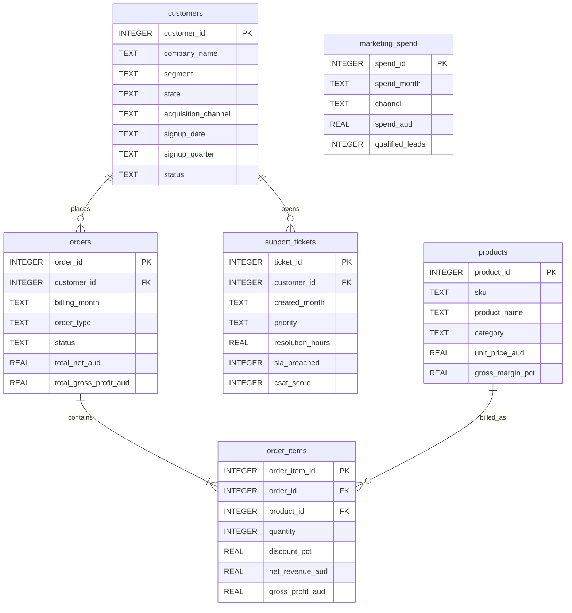

# Meridian BI — In-Browser SQLite Business Intelligence Platform

Meridian BI is an executive B2B SaaS analytics platform backed by a real, in-browser **SQLite WebAssembly (`sql.js`)** relational database. Every KPI, cohort retention cell, channel ROI metric, anomaly alert, and ad-hoc query in the application executes live SQL against a normalized 6-table star schema.

> **Dataset Disclosure:** All records in Meridian BI are generated deterministically on startup via a seeded Mulberry32 PRNG (`src/db/seed.ts`) representing a synthetic Australian B2B SaaS & commerce business across 2025–2026 (AUD).

---

## Core Capabilities

1. **Executive KPI Dashboard**: Real SQL-computed MRR, ARR, 6-month Net Revenue Retention (NRR), Gross Margin %, trailing 3-month CAC, and LTV:CAC ratio with period-over-period deltas, 22-month revenue & expansion trends (`LAG()` / `SUM() OVER`), segment & Australian state breakdowns, and automated SQL anomaly alerts with one-click drill-down.
2. **Cohort & Unit Economics**: Quarterly signup cohort retention heatmap (`2025-Q1` – `2026-Q3`) with toggleable Logo Retention % and Net Revenue Retention %, paired with full-funnel Marketing Channel ROI & CAC efficiency analysis.
3. **Live SQL Workbench**: Interactive read-only SQLite IDE with a collapsible Schema Explorer (introspected via `PRAGMA table_info` and `PRAGMA foreign_key_list`), 8 analytical SQL templates, millisecond execution timing, automatic chart preview for 2-column numeric results, paginated sortable table, and RFC-4180 CSV export.
4. **Data Dictionary & Lineage**: Visual star-schema topology, live column/key reference, and canonical business KPI formulas with direct Workbench execution.

---

## Architecture & Entity Relationship Model





---

## Canonical KPI Definitions

| Metric | Definition | Source Tables |
| --- | --- | --- |
| **MRR** | Sum of `total_net_aud` for `status = 'paid'` invoices in the latest billing month | `orders` |
| **ARR** | `MRR * 12` annualised recurring run-rate | `orders` |
| **NRR (6m)** | Trailing 6-month revenue retained from an existing paying cohort including expansions and churn | `orders` |
| **Gross Margin %** | `SUM(total_gross_profit_aud) / SUM(total_net_aud) * 100` for paid invoices | `orders`, `order_items`, `products` |
| **CAC** | Trailing 3-month `marketing_spend.spend_aud` divided by net new logos acquired in the same window | `marketing_spend`, `customers` |
| **LTV : CAC** | `(ARPA * Gross Margin %) / MAX(monthly_churn_rate, 1/36)` divided by trailing CAC | `orders`, `customers`, `marketing_spend` |

---

## Technical Decisions

- **Real SQL Execution Without a Backend**: Packaging `sql.js` with `public/sql-wasm.wasm` and Vite `base: './'` allows the entire relational engine to run deterministically in local development, Vitest Node suites, and static GitHub Pages deployments.
- **Defense-in-Depth Read-Only Guardrail**: `validateReadOnlyQuery()` strips SQL comments and quoted literals before rejecting multi-statement queries, DDL/DML keywords, and `PRAGMA` writes, while enforcing a 1,000-row result cap.
- **Deterministic Reproducibility**: Using a fixed-seed Mulberry32 PRNG ensures identical KPIs, cohort curves, and anomaly thresholds across sessions and automated tests.

---

## Local Development & Verification

```bash
# 1. Install dependencies
pnpm install

# 2. Copy SQLite WebAssembly binary to public/
pnpm run copy-wasm

# 3. Start local dev server
pnpm run dev

# 4. Typecheck, run SQLite unit tests, and build production bundle
pnpm run typecheck
pnpm test
pnpm run build
```

## License

MIT — see [LICENSE](./LICENSE).
